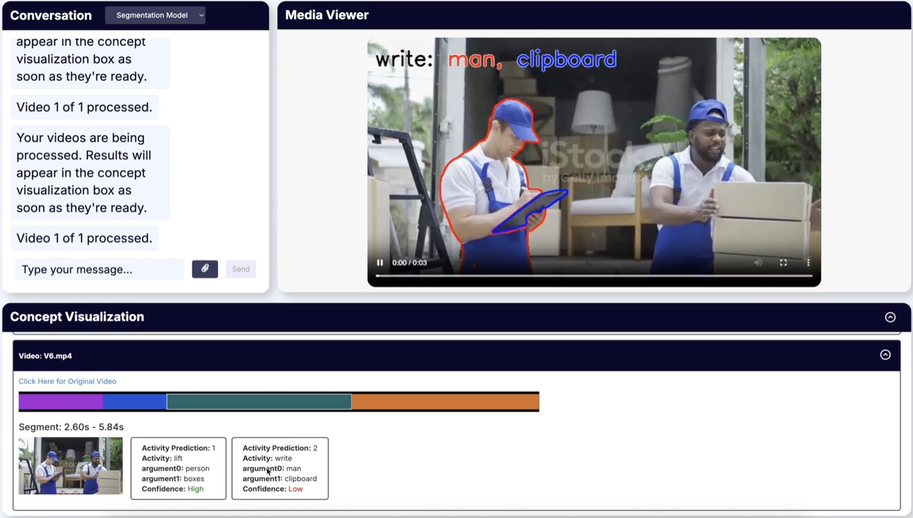
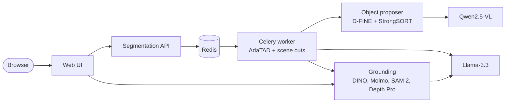

# CReLeRI: Explainable, Concept-Centric Video Analysis

[](https://doi.org/10.1145/3746027.3754479)
[](https://www.youtube.com/watch?v=2v0DDpFEq14)
[](https://github.com/michaelperez023/creleri-video/actions/workflows/ci.yml)
[](LICENSE)

CReLeRI finds the actions in long, untrimmed videos and shows the evidence for each one. It
splits a video into segments, predicts what happens in each segment as an action with its
arguments (*write: man, clipboard*), and grounds every argument in the video, in pixels and
in depth, before showing a prediction. Predictions that the video does not support are
rejected instead of reported. This repository is the complete system from our
[ACM Multimedia 2025 demo paper](https://doi.org/10.1145/3746027.3754479): the web UI, the
job pipeline and the model services.



## Highlights

- **Long, untrimmed video.** Segments a video at action and scene boundaries with a
  fine-tuned AdaTAD model and scene-cut detection, or into fixed windows.
- **Actions with arguments.** Qwen2.5-VL describes every tracked object, and Llama-3.3,
  constrained to a fixed vocabulary, turns those descriptions into ranked action
  predictions with their arguments.
- **Grounded in 3D.** Grounding DINO, Molmo, SAM 2 and Depth Pro locate each argument and
  check physical contact for actions that need it, which filters out hallucinations.
- **Explainable UI.** A segment timeline, predictions with confidence, and annotated clips
  that show the masks behind each prediction.
- **Swappable vocabulary and models.** Only the segmentation model is trained. The action
  list is a CSV file, and the LLM can be any OpenAI-compatible endpoint.
- **Built for long jobs.** Independent model services behind HTTP APIs, with a FastAPI +
  Celery/Redis job queue so hour-long analyses run in the background.

## My role

I'm the first author of the paper. For this system I:

- designed the architecture: independent model services connected over HTTP, with a
  FastAPI + Celery/Redis job queue for long-running video processing;
- integrated every component (temporal segmentation, object detection and tracking,
  Qwen2.5-VL captioning, Llama-3.3 action parsing, and 3D grounding) end to end with the
  web UI;
- fine-tuned the AdaTAD temporal action segmentation model.

The full author list is in the [citation](#citation).

## How it works



1. **Upload.** The web UI sends each video to the segmentation API, which queues a Celery
   task and returns a task id for the UI to poll.
2. **Segment.** The worker cuts the video at scene changes and at the action boundaries
   proposed by AdaTAD (a VideoMAEv2-giant backbone with adapters and an ActionFormer head).
   Uniform 5-second windows or the whole video are also available.
3. **Describe.** For each segment, the object proposer detects and tracks objects with
   D-FINE and StrongSORT, and Qwen2.5-VL writes three captions for every track.
4. **Predict.** Llama-3.3 maps each caption to an action from the vocabulary and extracts
   its arguments. Similar predictions are clustered, and each cluster's share becomes its
   confidence.
5. **Ground.** The grounding service finds every argument, tracks its mask through the
   segment, measures depth, and rejects predictions whose arguments should touch but don't.
   It renders an annotated clip for each accepted prediction.

Service APIs, configuration, and the reasoning behind the design are in
[docs/ARCHITECTURE.md](docs/ARCHITECTURE.md).

## Repository layout

```
web_ui/                      Flask web UI: upload, timeline, predictions, video player
adatad_temp_seg/             segmentation API (FastAPI), Celery worker, AdaTAD configs
  opentad/                   vendored OpenTAD, plus a single-video inference path
  segment_utils.py           segment selection and LLM-output parsing
dfine_obj_det/               vendored D-FINE object detector
  tools/inference/object_proposer_api.py   detection, tracking and captioning service
vlm_action_pipeline/
  demo_pipeline/             Qwen2.5-VL, Llama-3.3 and grounding services
  grounded_sam_2/            vendored Grounded-SAM-2 (SAM 2 and Grounding DINO)
scripts/start_all.sh         starts every service in tmux
docs/ARCHITECTURE.md         services, APIs, configuration and design notes
```

## Getting started

### Requirements

- Linux with NVIDIA GPUs and a CUDA 12.8 driver. The default GPU layout assumes one server
  with four large GPUs (developed on 4x NVIDIA B200); see [Configure](#configure) for
  other setups.
- conda, tmux, a C/C++ compiler, and the CUDA 12.8 toolkit (`nvcc`) to build the OpenTAD
  extensions.
- ffmpeg 7.x or earlier, built with the libx264 encoder (most distribution and conda-forge
  builds are). The result videos are H.264 so that browsers can play them, and FFmpeg 9
  removed the `-vsync` option that the pinned mediapy uses to read videos.
- An OpenAI-compatible endpoint serving Llama-3.3-70B-Instruct, for example
  [vLLM](https://docs.vllm.ai).
- About 110 GB of disk for model weights.

### Install

Run these from the repository root. Each service has its own environment.

**Segmentation service**

```bash
conda env create -f adatad_temp_seg/environment.yml     # creates "opentad4"
conda activate opentad4
cd adatad_temp_seg
pip install --no-build-isolation \
    ./opentad/models/utils/post_processing/nms \
    ./opentad/models/roi_heads/roi_extractors/align1d \
    ./opentad/models/roi_heads/roi_extractors/boundary_pooling
pip install gdown
gdown 1GZl1UIDW8Qs0-I-sgeEW1NAGL8plXA3M -O best.pth      # fine-tuned AdaTAD checkpoint
cd ..
```

The extensions compile with `nvcc`. If the build stops at a missing `cusparse.h` or
`cublas_v2.h` (a minimal CUDA install), point the compiler at the headers that PyTorch's pip
packages ship, then rerun the `pip install`:

```bash
export CPATH=$(ls -d "$CONDA_PREFIX"/lib/python3.10/site-packages/nvidia/*/include | paste -sd:)
```

**Object proposer**

```bash
conda env create -f dfine_obj_det/environment.yml       # creates "dfine2"
wget -P dfine_obj_det https://github.com/Peterande/storage/releases/download/dfinev1.0/dfine_x_obj365.pth
```

The tracker's re-identification weights are downloaded automatically on the first request.

**Captioner, action parser and grounding**

```bash
cd vlm_action_pipeline
conda env create -f qwen_environment.yml                # creates "qwen3"
conda env create -f ufllama_environment.yml             # creates "ufllama"
conda env create -f grounding_environment.yml           # creates "demo_pipeline"
conda activate demo_pipeline
pip install "depth_pro @ git+https://github.com/apple/ml-depth-pro.git@9e65e4dbe9568d23c546fcec53302b10445e109e"
pip install --no-build-isolation -e grounded_sam_2
wget -P demo_pipeline https://ml-site.cdn-apple.com/models/depth-pro/depth_pro.pt
cd ..
```

The grounding environment compiles NumPy 1.26 from source (Depth Pro needs NumPy 1.x on
Python 3.13), which takes a few minutes.

**Redis**

```bash
mkdir -p redis && cd redis
wget https://download.redis.io/redis-stable.tar.gz
tar -xzf redis-stable.tar.gz && make -C redis-stable/src     # the server only, no modules
cd ..
```

A `redis-server` already on your `PATH` works too.

**Web UI** (Python 3.10 or newer)

```bash
cd web_ui
python -m venv webui && source webui/bin/activate
pip install -r requirements.txt
cd ..
```

**Model weights**

| Weights | Location | Source |
|---|---|---|
| AdaTAD (fine-tuned) | `adatad_temp_seg/best.pth` | Google Drive, via `gdown` above |
| D-FINE-X, Objects365 | `dfine_obj_det/dfine_x_obj365.pth`, or set `DFINE_CKPT` | D-FINE release |
| Depth Pro | `vlm_action_pipeline/demo_pipeline/depth_pro.pt` | Apple |
| OSNet re-identification | `dfine_obj_det/tools/inference/` | downloaded by BoxMOT on first use |
| Qwen2.5-VL-32B, Grounding DINO, SAM 2, Molmo-7B-D, all-mpnet-base-v2 | Hugging Face cache | downloaded on first start |

Several of these have non-commercial licenses; see
[THIRD_PARTY_NOTICES.md](THIRD_PARTY_NOTICES.md).

### Configure

```bash
cp .env.example .env
```

Set `LLM_BASE_URL` (and `LLM_API_KEY` and `LLM_MODEL` if your endpoint needs them) to an
OpenAI-compatible server hosting Llama-3.3-70B-Instruct. For example, on separate GPUs run
`vllm serve meta-llama/Llama-3.3-70B-Instruct --tensor-parallel-size 4 --port 8000` and set
`LLM_BASE_URL=http://localhost:8000/v1`. Everything else has working defaults.

The default GPU layout for four GPUs:

| GPU | Services |
|---|---|
| 0 | object proposer; grounding (Depth Pro, Grounding DINO) |
| 1 | segmentation worker; grounding worker (SAM 2, Molmo); Qwen2.5-VL |
| 2, 3 | grounding workers (SAM 2, Molmo); Qwen2.5-VL |

Change it with `SEG_GPU`, `OBJDET_GPU` and `GROUNDING_GPUS` in `.env`. On smaller GPUs, pass
Qwen's memory per GPU and attention backend through `QWEN_ARGS`, for example
`QWEN_ARGS="--max-memory 70GiB --attn-implementation sdpa"`.

### Run

```bash
scripts/start_all.sh
```

This starts all eight processes in a tmux session named `creleri` (`tmux attach -t creleri`
to watch them, `tmux kill-session -t creleri` to stop them). The web UI is at
<http://localhost:5004>. The services listen only on localhost; to use the UI from another
machine, open a tunnel with `ssh -L 5004:localhost:5004 <server>`.

To start the services by hand instead, run each command in its own terminal:

| Service | Directory | Command |
|---|---|---|
| Redis | `redis/redis-stable` | `src/redis-server --port 17253` |
| Segmentation API | `adatad_temp_seg` | `conda activate opentad4 && python api.py -p 17249` |
| Segmentation worker | `adatad_temp_seg` | `conda activate opentad4 && CUDA_VISIBLE_DEVICES=1 python celery_worker.py -d 0` |
| Object proposer | `dfine_obj_det/tools/inference` | `conda activate dfine2 && CUDA_VISIBLE_DEVICES=0 python object_proposer_api.py` |
| Captioner | `vlm_action_pipeline/demo_pipeline` | `conda activate qwen3 && PYTHONNOUSERSITE=1 python qwen2p5_api.py` |
| Action parser | `vlm_action_pipeline/demo_pipeline` | `conda activate ufllama && python llama_3p3_api.py` |
| Grounding | `vlm_action_pipeline/demo_pipeline` | `conda activate demo_pipeline && python grounding_api.py -d 0 1 2 3` |
| Web UI | `web_ui` | `source webui/bin/activate && python app.py 5004` |

### Use

1. Open the web UI and choose a mode: **Segmentation Model**, **Uniform Segmentation**
   (5-second windows) or **No Segmentation**.
2. Click the paperclip and select one or more videos, up to 512 MB each.
3. When a video is processed, its timeline appears under **Concept Visualization**. Click a
   segment to play it, and click a prediction to watch the grounded clip in the
   **Media Viewer**.

### Customize the action vocabulary

- `adatad_temp_seg/action_categories.csv` lists the 99 actions the LLM can predict, each
  with a short gloss and an example sentence. Edit it to change the vocabulary; no
  retraining is needed.
- `vlm_action_pipeline/demo_pipeline/contact_required_actions.txt` lists the actions whose
  arguments must touch (such as *pick up*). Names must match the CSV.
- `adatad_temp_seg/category_idx_51.txt` holds the 51 classes the segmentation model was
  fine-tuned on. It only matters if you retrain that model (see below).

### Fine-tune the segmentation model

`best.pth` was fine-tuned with OpenTAD's AdaTAD recipe (a VideoMAEv2-giant backbone with
temporal-informative adapters and an ActionFormer head) on the 51 action classes in
`adatad_temp_seg/category_idx_51.txt`. Running CReLeRI needs only `best.pth`. To fine-tune
again, use upstream [OpenTAD](https://github.com/sming256/OpenTAD), since this repository
vendors only its `opentad` package:

1. Request the VideoMAEv2-giant checkpoint fine-tuned on Kinetics-710
   (`vit_g_hybrid_pt_1200e_k710_ft.pth`) through OpenGVLab's
   [request form](https://github.com/OpenGVLab/VideoMAEv2/blob/master/docs/MODEL_ZOO.md) and
   convert it with OpenTAD's script:

   ```bash
   python tools/model_converters/convert_videomaev2.py \
       vit_g_hybrid_pt_1200e_k710_ft.pth pretrained/vit-giant-p14_videomaev2-hybrid_pt_1200e_k710_ft_my.pth
   ```

   The public `OpenGVLab/VideoMAEv2-giant` model on Hugging Face is the self-supervised
   checkpoint without Kinetics-710 fine-tuning, in a different format, so it is not a
   drop-in replacement.
2. Start from OpenTAD's `configs/adatad/thumos/e2e_thumos_videomaev2_g_768x2_224_adapter.py`
   (the configs in `adatad_temp_seg/` record the settings used for `best.pth`), set
   `num_classes=51`, and point the dataset at your annotations and `category_idx_51.txt`.
3. Train, for example on four GPUs:

   ```bash
   torchrun --nnodes=1 --nproc_per_node=4 --rdzv_backend=c10d --rdzv_endpoint=localhost:0 \
       tools/train.py <your config>
   ```

4. Copy the best checkpoint to `adatad_temp_seg/best.pth`. The worker loads its EMA
   weights when the checkpoint has them.

## Development

The web UI, the segmentation API with its segment logic, and the Qwen and Llama services
have test suites that stub the models, so they run without GPUs or weights:

```bash
uvx ruff check . && uvx ruff format --check .
uv run --no-project --python 3.10 --with pytest --with-requirements web_ui/requirements.txt \
    pytest web_ui/tests -q
```

[CI](.github/workflows/ci.yml) runs the linters and all three test suites on every push.

## License

CReLeRI is released under the [GNU AGPL v3](LICENSE). It includes code vendored from
OpenTAD, D-FINE and Grounded-SAM-2 under their own licenses, and the model weights have
their own terms, some of them non-commercial; see
[THIRD_PARTY_NOTICES.md](THIRD_PARTY_NOTICES.md).

## Citation

If you use CReLeRI in your research, please cite:

```bibtex
@inproceedings{10.1145/3746027.3754479,
  author = {Perez, Michael Francis and Yang, Yichi and Zha, Yuheng and Ma, Enze and Tamboli, Danish and Ma, Haodi and Shahriari, Reza and Pathak, Vyom and Kasinets, Dzmitry and Venkatakrishnan, Rohith and Wang, Daisy (Zhe) and Ruiz, Jaime and Ragan, Eric D. and Hu, Zhiting and Xing, Eric and Zhu, Jun-Yan},
  title = {CReLeRI: Explainable, Concept-centric, Representation, Learning, Reasoning, and Interaction Video Analysis System},
  year = {2025},
  isbn = {9798400720352},
  publisher = {Association for Computing Machinery},
  address = {New York, NY, USA},
  url = {https://doi.org/10.1145/3746027.3754479},
  doi = {10.1145/3746027.3754479},
  booktitle = {Proceedings of the 33rd ACM International Conference on Multimedia},
  pages = {13528--13530},
  numpages = {3},
  location = {Dublin, Ireland},
  series = {MM '25}
}
```

## Acknowledgments

CReLeRI was developed at the Ruiz HCI Lab at the University of Florida. It builds on
[OpenTAD](https://github.com/sming256/OpenTAD) (AdaTAD),
[D-FINE](https://github.com/Peterande/D-FINE),
[BoxMOT](https://github.com/mikel-brostrom/boxmot),
[Grounded-SAM-2](https://github.com/IDEA-Research/Grounded-SAM-2) (SAM 2 and Grounding DINO),
[Molmo](https://huggingface.co/allenai/Molmo-7B-D-0924),
[Depth Pro](https://github.com/apple/ml-depth-pro),
[Qwen2.5-VL](https://github.com/QwenLM/Qwen2.5-VL) and
[Llama 3.3](https://www.llama.com).
