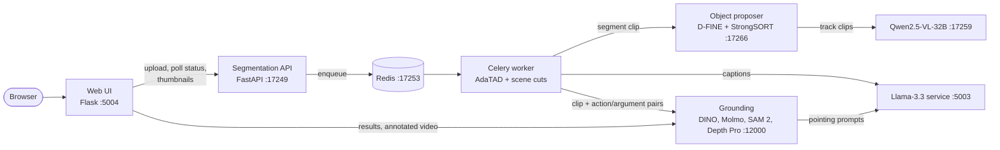
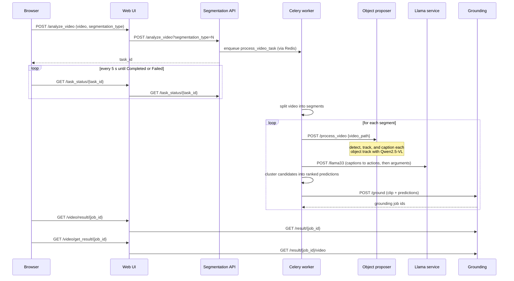

# Architecture

CReLeRI runs as eight processes on one GPU server: a web UI, a segmentation API with a
Celery worker and Redis queue, and four model services. They talk to each other over HTTP
on localhost, and the segmentation API, its worker and the object proposer exchange video
files by path, so they must share a filesystem.

## Services

| Service | Entry point | Framework | Port | Conda env | GPUs (reference setup) |
|---|---|---|---|---|---|
| Web UI | `web_ui/app.py` | Flask on Hypercorn | 5004 | venv `web_ui/webui` | none |
| Segmentation API | `adatad_temp_seg/api.py` | FastAPI on Uvicorn | 17249 | `opentad4` | none |
| Job queue | Redis | | 17253 | | none |
| Segmentation worker | `adatad_temp_seg/celery_worker.py` | Celery (solo pool) | | `opentad4` | 1 |
| Object proposer | `dfine_obj_det/tools/inference/object_proposer_api.py` | Flask | 17266 | `dfine2` | 1 |
| Captioner (Qwen2.5-VL-32B) | `vlm_action_pipeline/demo_pipeline/qwen2p5_api.py` | Flask | 17259 | `qwen3` | 3 |
| Action parser (Llama-3.3-70B) | `vlm_action_pipeline/demo_pipeline/llama_3p3_api.py` | Flask, proxying an OpenAI-compatible API | 5003 | `ufllama` | none (remote model) |
| Grounding | `vlm_action_pipeline/demo_pipeline/grounding_api.py` | FastAPI on Uvicorn | 12000 | `demo_pipeline` | 2 or more |



## Request flow



### Inside the worker

1. **Segmentation**, chosen per upload:
   - `0` (model): AdaTAD proposals (VideoMAEv2-giant backbone with adapters, ActionFormer
     head, 51 classes) run over overlapping 768-snippet windows and are filtered to the
     top non-overlapping proposals. Frame-difference scene cuts then split the video at
     shot changes, and the proposals split it further.
   - `1` (uniform): 5-second windows.
   - `2` (none): the whole video as one segment.
2. **Objects.** For each segment the object proposer detects Objects365 classes with
   D-FINE-X, tracks them with StrongSORT, keeps tracks that are present in at least 20%
   of the frames, and asks Qwen2.5-VL for three captions per track.
3. **Actions.** Llama-3.3 maps each caption to one action from
   `adatad_temp_seg/action_categories.csv` (constrained to that list) and then fills in its
   arguments. Sentence embeddings (all-mpnet-base-v2) clustered with DBSCAN merge
   equivalent predictions; a cluster's share of the votes becomes its probability.
4. **Grounding.** For each prediction the grounding service locates the arguments
   (Grounding DINO boxes matched to Molmo points), tracks their masks through the clip
   with SAM 2, estimates metric depth with Depth Pro, and checks physical contact for the
   actions listed in `contact_required_actions.txt`. Predictions that fail the check are
   marked invalid and get no visualization.

## HTTP APIs

### Web UI (`web_ui/app.py`)

| Method and path | Description |
|---|---|
| `GET /` | The single-page UI. |
| `POST /analyze_video` | Multipart `file` (video, up to 512 MB) and optional `segmentation_type` (`0`, `1` or `2`). Forwards the video to the segmentation API and returns `{"task_id"}`. Returns 400 for a bad request, 413 for an oversize file, the upstream status for upstream 4xx errors, and 502 when the backend fails. |
| `GET /task_status/<task_id>` | Proxies the segmentation API and rewrites thumbnail URLs to `/proxy/thumbnails/...`. Returns 503 `{"status": "Unavailable"}` while the backend is unreachable, so the page keeps polling. |
| `GET /proxy/thumbnails/<file>` | Thumbnail image from the segmentation API. |
| `GET /video/result/<job_id>` | Grounding job status (proxied). |
| `GET /video/get_result/<job_id>` | Annotated MP4 for a grounding job (streamed). |

### Segmentation API (`adatad_temp_seg/api.py`)

| Method and path | Description |
|---|---|
| `POST /analyze_video?segmentation_type=0\|1\|2` | Multipart `file`. Stores the video as `shared/<uuid>.mp4`, enqueues the task and returns 201 `{"task_id"}`. Returns 415 for non-video uploads and 422 for an invalid `segmentation_type`. |
| `GET /task_status/{task_id}` | `{"status": "Processing"}`, `{"status": "Failed", "error"}`, or `{"status": "Completed", "result"}` (below). |
| `GET /thumbnails/{file}` | Segment thumbnails. |

A completed result looks like this (abridged):

```json
{
  "proposals": {"<video id>": [{"segment": [2.6, 5.84], "score": 0.91}]},
  "results": [
    {
      "segment": [2.6, 5.84],
      "thumbnail": "thumbnail_<video id>_1_<timestamp>.jpg",
      "results": {
        "valid_parsed_actions_0": [
          {"pattern": {"action": "write", "argument0": "man", "argument1": "clipboard"},
           "probability": 0.5, "caption": "..."}
        ]
      },
      "api_response": ["<grounding job id>"]
    }
  ],
  "thumbnails": [{"segment": [2.6, 5.84], "thumbnail_url": ".../thumbnails/thumbnail_..."}]
}
```

A segment whose detection, LLM or grounding step fails carries an `"error"` string, and the
other segments still complete.

### Object proposer (`object_proposer_api.py`)

`POST /process_video` with `{"video_path": "<local file>"}` returns
`{"message", "objects": [label, ...], "captions": [[c1, c2, c3], ...], "videos": []}`, with
`captions[i]` belonging to `objects[i]`. Returns 400 unless `video_path` names an existing
local file. Requests are handled one at a time.

### Qwen2.5-VL captioner (`qwen2p5_api.py`)

`POST /qwen` (multipart): `messages` is a JSON conversation in Qwen chat format, or a list of
conversations when `is_batch` is true; attach one `video` file or one or more `image` files.
Returns `{"response": str}` or `{"response": [str, ...]}`. Messages may only refer to the
uploaded media; anything else is rejected with 400.

### Action parser (`llama_3p3_api.py`)

`POST /llama33` (JSON): `{"messages", "constraint_words"?, "is_batch"?}`. With
`constraint_words` the model must answer with one of the given labels (JSON-schema
constrained, with a numbered fallback that defaults to `"none"`). Returns
`{"response": str}` or `{"response": [str, ...]}`.

### Grounding (`grounding_api.py`)

| Method and path | Description |
|---|---|
| `POST /ground` | Multipart `video` and an `inputs` JSON field `{"subject_object_pairs": [{"argument_names", "action", "caption"}]}`. Returns one job id per pair and processes them in the background. |
| `GET /result/{id}` | `{"id", "status", "has_visualization", "extra_info"}`, with `status` one of `PENDING`, `SUCCESS_VALID`, `SUCCESS_INVALID`, `EXCEPTION`, `CANCELLED`. 404 once results have expired. |
| `GET /result/{id}/video` | Waits for the job; returns the annotated MP4 (200), no visualization (204), failure (500) or cancellation (444). |
| `GET /result/{id}/masks` | Same, but returns the per-argument masks as an `.npz` archive. |
| `DELETE /result`, `DELETE /result/{id}` | Drop stored results; pending jobs are cancelled. |

Finished results are kept for `--result-ttl` seconds (one day by default), because the web UI
only fetches them after the whole video has been processed.

## Configuration

Every setting has a default that matches the single-host setup, so nothing needs to be
configured to run on one machine apart from the LLM endpoint. `scripts/start_all.sh` loads
the repo-root `.env` (see `.env.example`).

| Variable | Read by | Default |
|---|---|---|
| `CRELERI_HOST` | every HTTP service (bind address) | `127.0.0.1` |
| `SEGMENTATION_API_URL` | web UI | `http://localhost:17249` |
| `GROUNDING_API_URL` | web UI, worker | `http://localhost:12000` |
| `REDIS_URL` | segmentation API, worker | `redis://localhost:17253/0` |
| `LLAMA_API_URL` | worker, grounding | `http://localhost:5003` |
| `OBJECT_PROPOSER_URL` | worker | `http://localhost:17266` |
| `QWEN_API_URL` | object proposer | `http://localhost:17259` |
| `LLM_BASE_URL`, `LLM_API_KEY`, `LLM_MODEL` | Llama service | required, none, `llama-3.3-70b-instruct` |
| `DFINE_CKPT` | object proposer | `dfine_obj_det/dfine_x_obj365.pth` |
| `SAM2_CACHE_DIR`, `GROUNDING_UPLOAD_DIR` | grounding | private folders in the system temp directory |
| `MOLMO_REVISION` | grounding | unset: the latest or locally cached Molmo code |

Each server also takes `--host` and `--port` flags. `qwen2p5_api.py` takes `--model`,
`--max-memory` (one size per GPU) and `--attn-implementation` for other hardware, and
`grounding_api.py` takes `-d/--devices`, `--result-ttl`, `--depth_pro_ckpt` and
`--contact-required-file`.

## Runtime files

| Path | Written by | Lifetime |
|---|---|---|
| `adatad_temp_seg/shared/` | segmentation API and worker | uploads and segment clips, deleted when the task or segment finishes |
| `adatad_temp_seg/thumbnails/` | worker | kept, served to the UI |
| `<tmp>/sam2_cache_<uid>/` | grounding | frames for SAM 2, deleted per request |
| `<tmp>/grounding-uploads-<uid>/` | grounding | uploaded clips, deleted per request |
| per-request temp folders | object proposer, captioner | deleted after each request |

## Design decisions

- **One service per model.** The models need incompatible environments (Python 3.10 and
  3.13, different PyTorch builds, flash-attn), different GPU layouts, and minutes of load
  time. Separate HTTP services let each one keep its own environment, load once, and be
  restarted or replaced on its own.
- **Background jobs.** Processing a long video takes minutes to hours, so the segmentation
  API only enqueues a Celery task and returns an id. The worker takes one task at a time
  (one GPU, prefetch 1) with a long Redis visibility timeout, and the UI polls for status.
- **Fail per segment, not per video.** Every inter-service call has a timeout. A segment
  whose detection, LLM or grounding step fails reports an error while the other segments
  complete, and grounding jobs always end in a final state.
- **Fixed vocabulary, swappable models.** Only the segmentation model is trained. Actions
  come from a CSV that the LLM is constrained to, so the vocabulary can change without
  retraining, and any OpenAI-compatible endpoint can serve the LLM.
- **Localhost by default.** The services have no authentication. They bind to `127.0.0.1`
  unless `CRELERI_HOST` says otherwise; reach the UI remotely through an SSH tunnel.
